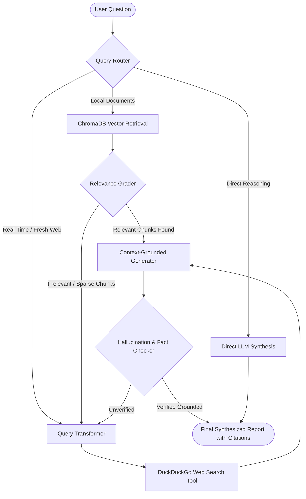

# 🧠 Autonomous Fact-Checked Research Agent (Agentic RAG)

[](https://www.python.org/)
[](https://langchain-ai.github.io/langgraph/)
[](https://www.trychroma.com/)
[](https://ollama.com/)
[](https://streamlit.io/)

An end-to-end **Agentic AI & Corrective Retrieval-Augmented Generation (CRAG)** system built with **LangGraph**, **ChromaDB**, and **Ollama**. Unlike naive linear RAG, this system autonomously evaluates retrieval quality, rewrites underperforming queries, fetches live web search fallbacks, and verifies output groundedness to eliminate hallucinations.

---

## 📌 Generative AI vs. Agentic AI: Why This Matters

| Capability | Naive Generative RAG | This Project (Agentic RAG) |
| :--- | :--- | :--- |
| **Execution Flow** | Fixed linear pipeline: `Query -> Embed -> Top-K -> Generate` | Dynamic state graph with conditional branches, loops, and tools |
| **Decision Autonomy** | None (always queries vector DB, even for greetings) | **Query Router** determines whether vector search, web search, or direct reasoning is best |
| **Retrieval Validation** | Blind trust in retrieved chunks | **Relevance Grader** evaluates each document before passing to generator |
| **Failure Recovery** | Hallucinates or yields poor answers on sparse data | **Self-Correction Loop** triggers query rewriting and live web search tool fallback |
| **Fact-Checking** | None | **Hallucination Grader** validates answer against ground truth sources |

---

## 🏗️ Architecture & State Machine



---

## 🚀 Key Features

1. **Autonomous Query Routing**: Categorizes queries into `vectorstore`, `websearch`, or `direct` execution paths.
2. **Document Relevance Grading**: Uses binary self-evaluation to filter out noisy or irrelevant text chunks.
3. **Automated Search Query Transformation**: Reformulates failed user queries into high-precision search keywords.
4. **Live Web Tool Fallback**: Automatically searches DuckDuckGo for missing context without requiring paid search APIs.
5. **Hallucination & Grounding Guard**: Enforces strict factual consistency against the provided context blocks.
6. **Provider Agnostic**: Runs 100% locally on **Ollama** (`llama3.2:3b`), with seamless fallback support for **Groq** and **Google Gemini**.
7. **Interactive Dashboard**: Streamlit interface displaying real-time execution graphs and source references.

---

## 📁 Repository Structure

```
agentic-rag-researcher/
├── .venv/                      # Isolated virtual environment
├── src/
│   ├── __init__.py
│   ├── config.py               # Model provider and path configurations
│   ├── agent_state.py          # TypedDict state schema for LangGraph
│   ├── vectorstore.py          # ChromaDB chunking, indexing, and retrieval
│   ├── tools.py                # DuckDuckGo web search tool integration
│   ├── agent_nodes.py          # Functional state machine nodes
│   └── workflow.py             # LangGraph compilation and streaming pipeline
├── data/
│   ├── sample_docs/            # Default knowledge base documents
│   └── chroma_db/              # Persisted vector database
├── app.py                      # Interactive Streamlit dashboard
├── requirements.txt            # Project dependencies
├── .env.example                # Environment configuration template
└── README.md                   # Documentation & portfolio showcase
```

---

## 🛠️ Quick Start Guide

### 1. Prerequisites & Environment Setup
Clone this repository and ensure the virtual environment is active:
```powershell
cd A:\Personal-Dev\agentic-rag-researcher
.\.venv\Scripts\Activate.ps1
```

### 2. Configure Environment
Copy `.env.example` to `.env`:
```powershell
Copy-Item .env.example .env
```

### 3. Running with Local Ollama (Recommended)
1. Install [Ollama](https://ollama.com/download/windows).
2. Pull the recommended lightweight model and embedding:
   ```powershell
   ollama pull llama3.2:3b
   ollama pull nomic-embed-text
   ```

### 4. Running the Dashboard
Launch the interactive Streamlit application:
```powershell
streamlit run app.py
```
Open `http://localhost:8501` in your browser.

---

## 📊 Portfolio Demonstration Scenarios

- **Scenario A (Vector Retrieval)**: Click **"Test Local RAG"** to query indexed architectural documents. Notice the retriever surfacing chunks and the relevance grader verifying each before synthesis.
- **Scenario B (Web Fallback)**: Click **"Test Web Fallback"** with a query about recent breakthroughs. Notice the router or grader triggering query transformation and DuckDuckGo live search automatically.
- **Scenario C (Direct Reasoning)**: Click **"Test Direct Reasoning"** to see the system bypass retrieval entirely for pure conceptual questions, minimizing latency.
